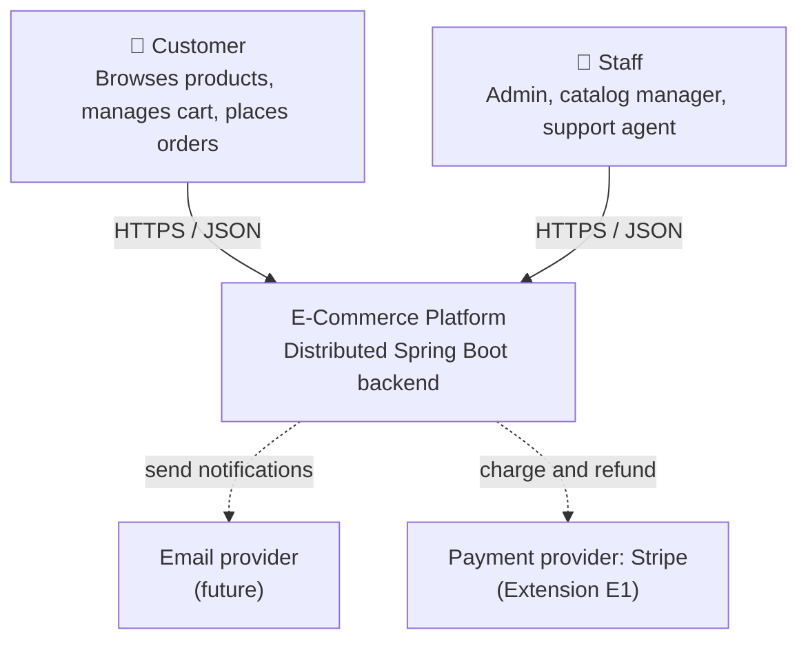

# 01. System Context

**Question:** Who uses the platform, and which external systems does it depend on?

This is the "zoomed out" view. The platform is one box here; [02-containers.md](02-containers.md) shows what's inside it.

Dashed lines mean "not built yet".

## Users and what they can do

| Actor | Role(s) | Main capabilities |
|---|---|---|
| Customer | `CUSTOMER` | Register, log in, browse the catalog, manage cart, place orders, view **own** orders |
| Catalog manager | `CATALOG_MANAGER` | Create and edit products, prices and inventory |
| Support agent | `SUPPORT_AGENT` | View **any** order and user (read-only), cancel orders |
| Order manager | `ORDER_MANAGER` | Move orders through fulfillment (ship, deliver) |
| Admin | `ADMIN` | Everything, plus granting and revoking roles |

The exact permissions behind each role are defined in [the database design](../db/).

## Out of scope (for now)

- Frontend (Swagger UI and Postman are the clients)
- Multi-tenant or marketplace sellers
- Multi-currency pricing
