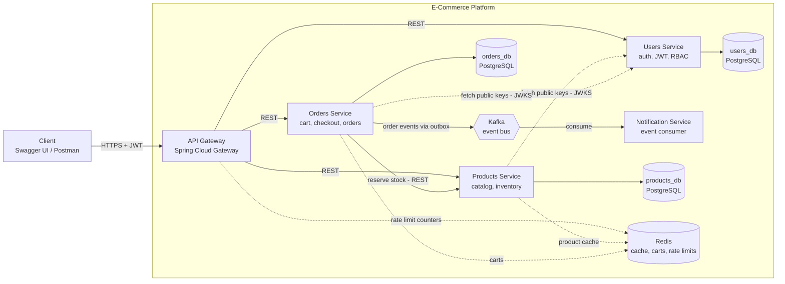

# 02. Containers

**Question:** Which services, databases and brokers exist, and how do they connect?

"Container" in C4 means a separately deployable thing (a service, a database, a broker), not specifically a Docker container. In this project, each one does also run as a Docker container.

## Containers

| Container | Tech | Owns | Built in |
|---|---|---|---|
| API Gateway | Spring Cloud Gateway | none | Week 12 |
| Users Service | Spring Boot | `users_db` | Weeks 2–5 |
| Products Service | Spring Boot | `products_db` | Weeks 6–8 |
| Orders Service | Spring Boot | `orders_db` | Weeks 9–11 |
| Notification Service | Spring Boot + Spring Kafka | processed-event store | Week 13 |
| PostgreSQL | PostgreSQL | one database per service | Week 1 |
| Redis | Redis | cache, carts, rate-limit counters | Week 6 |
| Kafka | Kafka (KRaft mode) | topics | Week 13 |

## Rules this diagram enforces

1. **Database per service.** An arrow into a database only ever comes from its owning service.
2. **No synchronous call chains longer than one hop.** Orders calls products; products never calls orders back.
3. **Facts are shared through events, not shared tables.** Anything that only needs to *know* something happened subscribes to Kafka.
4. **Auth is verified locally.** Services fetch users-service's public key once and cache it; there's no per-request call to users-service.

## Not shown yet

Observability (Prometheus, Grafana, OpenTelemetry), search (Elasticsearch) and payments get added to this diagram when they're built.
