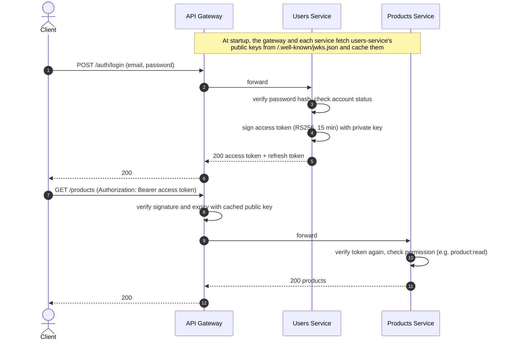
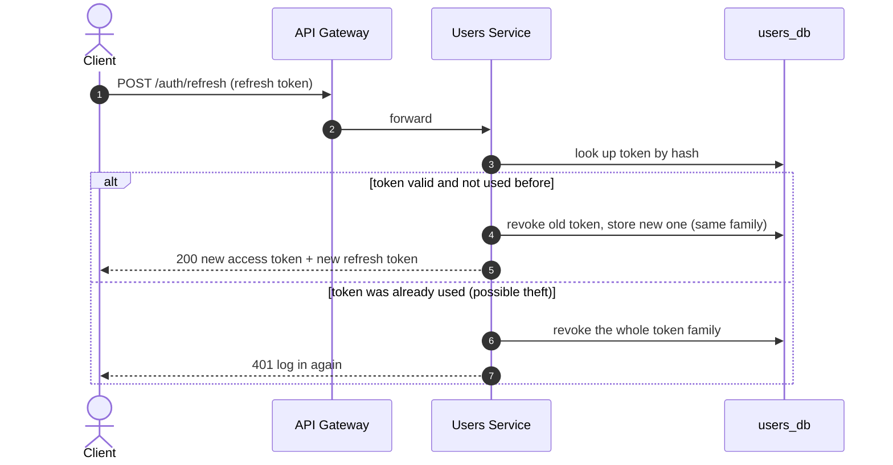

# Flow: Authentication

**Question:** How do login, token refresh and token verification work?

**Status:** 🟡 Target design, built in Week 4

## Login, then calling another service

## Refresh with rotation

## Key decisions (fill in as you build)

- Why RS256 (asymmetric) rather than HS256 (shared secret)? → _ADR to write in Week 4_
- Why verify at both the gateway and the service? → _your answer here_
- Where does the client keep the refresh token? → _your answer here_
