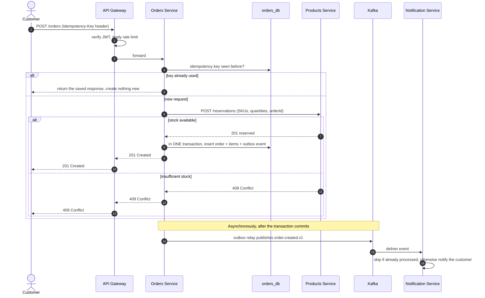
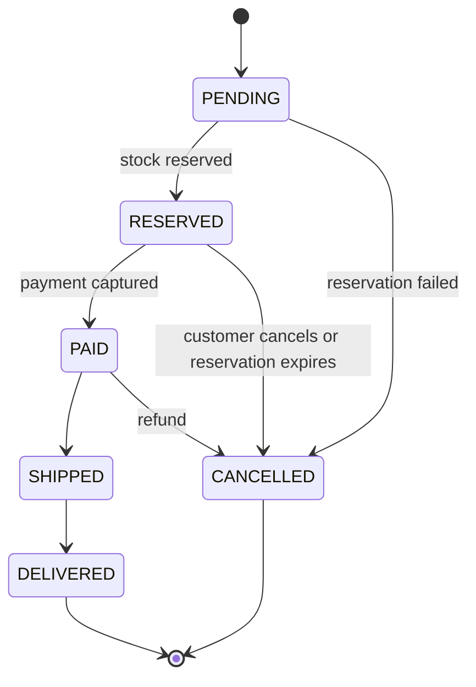

# Flow: Checkout

**Question:** What happens when a customer places an order, including when things fail?

**Status:** 🟡 Target design, built in Weeks 9–11

## Place order

## Failure cases to design for

| What fails | What happens | Pattern |
|---|---|---|
| Client retries after a timeout | The same order is returned, no duplicate created | Idempotency key |
| Products service is slow or down | Fail fast after a timeout, return 503 | Timeout + retry with backoff + circuit breaker |
| Stock reserved, but the order insert fails | Reservation released (compensation), or it expires on its own | Compensating action + reservation TTL |
| Kafka is down when the order commits | Event waits in the outbox table and is published later | Transactional outbox |
| Notification service gets the same event twice | Second copy is ignored | Idempotent consumer |
| Event keeps failing to process | Moved aside after N retries for inspection | Retry topic + dead-letter queue |

## Order lifecycle

## Key decisions (fill in as you build)

- Why reserve stock synchronously instead of through an event? → _your answer here_
- Why store a price snapshot on each order line? → _your answer here_
- What's the reservation TTL, and why that value? → _your answer here_
